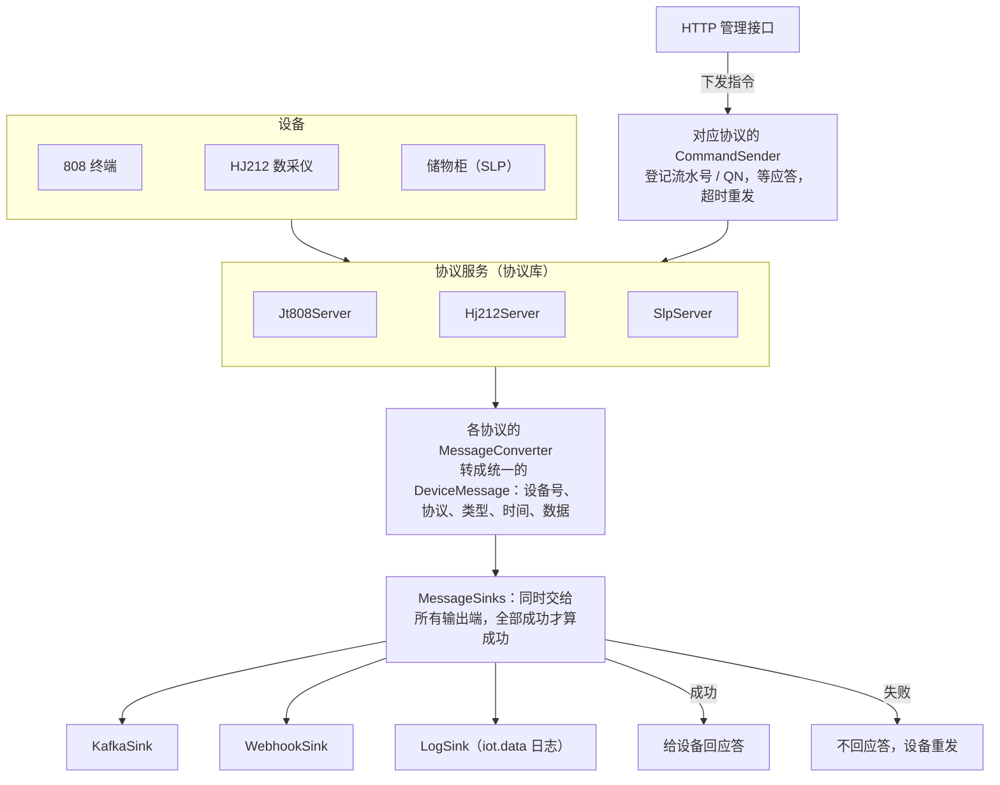

# iot-protocol-gateway

基于 Netty 的国标 IoT 协议接入网关。支持 **JT/T 808（2013 / 2019）、HJ212（2005 / 2017 / 2025）** 和一个示例私有协议 **SLP**，自带**设备模拟器**：没有真机也能跑起来。

> 🚧 项目处于早期阶段，接口可能还会调整。欢迎 Star 关注进度。
>
> 仓库地址：[GitHub](https://github.com/xiaowu-iot/iot-protocol-gateway) · [Gitee（国内镜像）](https://gitee.com/xiaowu-iot/iot-protocol-gateway)

## 为什么做这个项目

做过车联网、环保监测或智能硬件对接的同学大概都有体会：

- 协议文档几十页，真正对接时才发现转义、分包、版本差异这些细节处处是坑；
- 网上的资料东一篇西一篇，很少有从 **报文结构 → Netty 实现 → 跑起来看效果** 讲完整的；
- 手上没有终端设备，想调试只能等现场联调。

这个项目想把这些问题一次解决：**协议库可以直接拿去用，模拟器可以直接拿来调，文档把原理讲透。**

## 特性

- **协议库零依赖 Spring**：纯 Java + Netty，兼容 JDK 8，可以直接嵌入现有系统
- **JT/T 808**：注册、鉴权、心跳、位置上报、批量补传；参数查询设置、文本下发、终端控制、拍照、透传等常用指令；分包合包；2013 / 2019 双版本
- **HJ212-2017**：实时数据，分钟、小时、日数据，常用反控指令，CRC 校验；兼容 2005 版数采仪（因子编码自动转换）
- **HJ212-2025**（2026-01-01 实施）：按 Flag 版本号（Flag=8~11）自动识别，应答用设备自己的版本；SM4 加密报文解密（密钥按 MN 配置）；心跳包 9015 回 9013；补传标志 RF；新的数据标记（B 在 2025 版是闷炉）；UTF-8 中文日志。详见下面的 [HJ212-2025 接入](#hj212-2025-接入)
- **SLP 示例协议**：一个完整设计的私有二进制协议（[协议文档](iot-protocols/iot-slp/PROTOCOL.md)），演示怎样从零设计、实现私有协议
- **编解码基础设施**：转义帧、长度帧、ASCII 帧解码器，半包、粘包、垃圾数据处理，指令应答匹配，会话管理
- **网关应用**：Spring Boot 3，统一消息模型，输出到日志 / Kafka / Webhook，HTTP 管理接口下发指令
- **连接记录和指令记录**：每台设备的连接、注册鉴权（成功失败和原因）、上下线、断开（心跳超时、连接异常），通过接口下发的每条指令和设备应答，都能按设备查
- **设备模拟器**：一条命令模拟成百上千台 808 终端、212 数采仪、储物柜，带随机轨迹、断线重连、盲区补传、紧急报警等场景
- **HJ212 网页调试工具**：浏览器里扮演一台现场机，收发 2005 / 2017 / 2025 版的全部报文，平台命令可自动或手动应答，详见 [HJ212 网页调试工具](#hj212-网页调试工具)

## 快速开始

环境：JDK 17+、Maven 3.6+。

协议库还没发布到中央仓库，先把它装到本地：

```bash
git clone https://github.com/xiaowu-iot/iot-protocols.git
# 国内访问慢的话用 Gitee 镜像：https://gitee.com/xiaowu-iot/iot-protocols.git
cd iot-protocols
mvn clean install -DskipTests
cd ..
```

再构建网关和模拟器：

```bash
git clone https://github.com/xiaowu-iot/iot-protocol-gateway.git
# 国内访问慢的话用 Gitee 镜像：
# git clone https://gitee.com/xiaowu-iot/iot-protocol-gateway.git
cd iot-protocol-gateway
mvn clean package -DskipTests
```

启动网关：

```bash
java -jar iot-gateway/target/iot-gateway-0.1.0-SNAPSHOT.jar
```

另开一个终端，启动 10 台模拟 808 终端，每 10 秒上报一次位置：

```bash
java -jar iot-simulator/target/iot-simulator-0.1.0-SNAPSHOT.jar jt808 --count 10 --interval 10
```

网关日志里就能看到终端注册、鉴权、上线和位置数据。查询在线设备、查询某台终端的位置：

```bash
curl http://localhost:8080/api/devices
curl http://localhost:8080/api/jt808/13800138000/location
```

查某台终端的连接记录（连接、鉴权、上下线、断开）和指令记录：

```bash
curl "http://localhost:8080/api/audit/connections?deviceId=13800138000"
curl "http://localhost:8080/api/audit/commands?deviceId=13800138000"
# 只看鉴权失败的、只看没成功的指令
curl "http://localhost:8080/api/audit/connections?event=AUTH&success=false"
curl "http://localhost:8080/api/audit/commands?success=false"
```

还可以加 `protocol`（jt808 / hj212 / slp）、`since`（如 `2026-10-20T08:00:00Z`）、`limit`（默认 100）。内存里只留最近 5000 条（`iot.audit.max-records`），每条记录同时写到 `logs/iot-audit.log`（一行一条 JSON，保留 90 天），更早的到文件里查。

## HJ212-2025 接入

HJ212-2025 从 2026 年 1 月 1 日起实施，替代 2017 版。帧格式、CRC 和 2017 版一样，网关按 Flag 里的版本号自动识别（2017 版 Flag 是 4~7，2025 版是 8~11），同一个端口新旧设备可以混接，不用额外配置。和 2017 版相比，网关处理了这些变化：

| 变化 | 网关的处理 |
|---|---|
| Flag 版本号改成 2 | 应答（9011 / 9013 / 9014）和下发的命令都用设备自己的版本号，2025 版设备收到的是 Flag=8 / 9 |
| 数据段加密（SM4，ECB，不填充） | 只有 `CP=&&` 和 `&&` 之间是密文，最后不足 16 字节的部分保持明文；长度和 CRC 按明文算。网关先按明文校验 CRC，对不上再用这台设备的密钥解密后校验 |
| 心跳包 9015 | 刷新在线状态，要求应答的回 9013，不送下游 |
| 补传标志 RF=1 | 下游消息带 `"refill": true`，入库可以，别拿来触发实时报警 |
| 分包每包 QN 不同 | 2025 版每包单独应答、单独交给下游，不再按 QN 合包 |
| 数据标记最长 3 位 | 支持 Td、St、Stc、Sth、Sd、Sr 等新标记；**B 在 2017 版是通讯异常，2025 版是闷炉**，`flagName` 按版本给出 |
| 汉字用 UTF-8 | 长度按 UTF-8 字节算；现场机日志 `//...//` 里的分号、逗号不拆开 |
| 新增参数编码 | 用电（d 开头）、关键生产工况（p 开头，比如 p11a01）、噪声（LA、Leq……） |

加密传输的设备，在网关配置里按 MN 配通信密钥（16 个字符，就是下发给设备的 NewSK）。密钥更新的过渡期可以配新旧两把，逗号分隔：

```yaml
iot:
  hj212:
    secret-keys:
      "[010000A8900016F000169DC0]": ${HJ212_KEY_DEVICE1}
```

密钥别写进代码仓库，用环境变量或外部配置文件传进去。没配密钥的设备发来加密报文，CRC 对不上，会被丢弃并记日志。

只用协议库的话：`Hj212Server.builder().keys(mn -> 查密钥)`，或者 `Hj212Codecs.addTo(pipeline, keys)`。

## HJ212 网页调试工具

对接环保平台时，最常见的需求是"手上没有数采仪，想看看平台对每条报文怎么反应"。模拟器带了一个网页版调试工具，在浏览器里扮演一台现场机：

```bash
java -jar iot-simulator/target/iot-simulator-0.1.0-SNAPSHOT.jar web
# 浏览器打开 http://127.0.0.1:8090，端口用 --port 改
```

浏览器不能直接开 TCP 连接，所以由本机的工具后台替页面连平台。后台默认只监听 127.0.0.1，它能连任意地址，开放到局域网（`--bind 0.0.0.0`）要谨慎。

能做的事：

- **三个版本**：2005 / 2017 / 2025 切换，Flag 版本位、实时数据间隔范围、分包 QN 规则按版本处理
- **上行报文**：实时、分钟、小时、日数据，设备运行状态、运行时间，开机时间，校时请求 1013，现场机信息 3020（日志、状态、参数）；2025 版的心跳 9015、硬件序号 1001（MN 为空）、获取新密钥 1014、原始监测数据 2013、噪声 2052、标样核查 2062、炉膛温度 2111、留样信息 3015、唯一标识 3019。模板按标准附录 C 生成，CP 可以随便改，发出前实时预览整帧（长度、CRC、密文）
- **发送选项**：要求应答、RF=1 补传、分包（2025 版每包新 QN）、SM4 加密（自动 / 强制 / 关闭）、故意写错 CRC；要求应答的报文按 OverTime / ReCount 超时重发，收到 9014 / 9013 显示耗时
- **平台命令自动应答**：1000、1002（按硬件序号认领 MN）、1011 / 1012（校时会改设备时钟）、1014（换密钥，旧密钥过渡期内还能解密）、1061~1064、1072、2011 / 2012、2021 / 2022、历史数据 2013 / 2031 / 2041 / 2051 / 2061 / 2062、3011~3024。按附录 C 的流程回 9011 → 数据 → 9012，通知命令回 9013；MN、密码、CRC 不对回对应的 QnRtn
- **手动应答**：关掉自动应答，每条收到的命令下面有 9011 / 9012 / 9013 / 9014 按钮，用来测平台的超时重发、拒绝、执行失败等分支；也可以设置"丢弃接下来 N 条命令"
- **自动上报**：实时数据、分钟数据、整点小时数据和零点日数据、心跳、连上后请求校时、断线重连
- **报文日志**：上下行、加密报文的原文和解密结果、字段表、十六进制；另有"报文解析"页，粘贴任意报文（整帧、数据段或十六进制）看 CRC 和字段

## 项目结构

```
iot-protocol-gateway
├── iot-gateway            接入网关应用（Spring Boot 3，JDK 17+）
├── iot-simulator          设备模拟器和 HJ212 网页调试工具（JDK 17+）
└── iot-docs               文档和入门文章
```

协议库在独立的仓库 [iot-protocols](https://github.com/xiaowu-iot/iot-protocols)（JDK 8+，不依赖 Spring）：底座、JT/T 808、JT/T 1078、HJ212、SLP，网关和模拟器按版本号依赖它。

## 工作流程

各协议自己的处理流程（808 接入时序、解码流水线、指令应答匹配、HJ212 命令交互、SLP 升级……）画在协议库 [iot-protocols](https://github.com/xiaowu-iot/iot-protocols#工作流程) 的 README 里，这里画网关这一层。

所有协议的数据先转成统一的 `DeviceMessage`（JSON），再交给输出端；**输出成功之后才给设备回应答**，下游（Kafka、Webhook）出故障时设备收不到应答会重发，数据不会在网关里丢。



## 默认端口

| 服务 | 端口 |
|---|---|
| JT/T 808 | 7611 |
| HJ212 | 7613 |
| SLP | 7614 |
| HTTP 管理接口 | 8080 |
| HJ212 网页调试工具 | 8090 |

## 入门文章

《Java 程序员的 IoT 协议入门》系列，写给想转物联网的 Java 程序员：

1. [物联网平台到底在做什么](iot-docs/docs/articles/01-what-is-iot-platform.md)
2. [设备是怎么连上平台的：TCP、MQTT、HTTP、DTU](iot-docs/docs/articles/02-how-devices-connect.md)
3. [国内的 IoT 为什么绕不开国标协议](iot-docs/docs/articles/03-why-national-standards.md)
4. [二进制基础：Java 程序员读协议的第一关](iot-docs/docs/articles/04-binary-basics.md)
5. [手把手解析第一条 JT/T 808 报文](iot-docs/docs/articles/05-parse-first-jt808-message.md)
6. [TCP 拆包粘包：设备接入绕不开的第一个坑](iot-docs/docs/articles/06-tcp-sticky-packets.md)

## 路线图

✅ 已完成 · 🚧 进行中 · 📋 计划中

### 协议详解

每个协议一篇详解，从报文结构讲到 Java 实现，再到现场对接时踩过的坑：

| 协议 | 场景 | 状态 |
|---|---|:---:|
| JT/T 808（2013 / 2019） | 车载终端：定位、报警、指令、多媒体 | 🚧 |
| HJ212-2017 / 2025 | 环保在线监测：数采仪上报、反控、2025 版加密传输 | 🚧 |
| SLP 示例协议 | 从零设计一个私有二进制协议 | 🚧 |
| JT/T 808 行业扩展 | 主动安全（ADAS / DSM）报警附件、油箱油量、加油偷油识别 | 📋 |
| JT/T 809 | 平台与平台之间的数据转发 | 📋 |
| JT/T 1078 | 车载音视频 | 📋 |
| Modbus RTU / TCP | 工业现场：点表、字序、轮询 | 📋 |
| DL/T 645、CJ/T 188 | 电表、水表、热量表抄表 | 📋 |
| GB 26875 | 城市消防远程监控 | 📋 |
| MQTT | 新设备的主流接入方式，和 TCP 私有协议的取舍 | 📋 |
| DTU 透传 | 串口设备通过 4G 联网：注册包、心跳包、多设备排队 | 📋 |

### 平台能力

- 📋 OTA 远程升级：断点续传、限流、失败止损
- 📋 轨迹存储与回放、电子围栏
- 📋 监控运维：连接数、吞吐量、报文日志、告警
- 📋 网关集群与单机 10 万长连接压测

### AI 视觉识别（智慧环卫）

摄像头拍到的画面，用训练好的模型自动识别问题，识别结果通过网关上报平台、生成告警和工单：

| 识别场景 | 说明 | 状态 |
|---|---|:---:|
| 垃圾桶满溢 | 桶内垃圾超过桶口，提醒及时清运 | 📋 |
| 垃圾暴露 | 垃圾散落在桶外、未按要求收集 | 📋 |
| 地面垃圾 | 道路、广场上的纸屑、塑料袋等散落垃圾 | 📋 |
| 占道经营 | 流动摊贩占用道路、人行道经营 | 📋 |

每个场景都会讲完整流程：采集图片 → 数据标注 → 模型训练 → 评估调优 → 部署到边缘盒子或服务端 → 识别结果接入物联网平台告警。

## 想系统学、做完整的平台？

这个仓库是**基础版**：协议库、网关骨架和模拟器，够你把设备接进来、跑通整个流程。

真实项目里还有很多仓库里没有的东西。我在知识星球 **「小物学长的物联网实战营」** 里，带大家 20 周从零做出一个完整的物联网接入平台，代码比这里全得多：

| 内容 | 仓库（基础版） | 实战营 |
|---|:---:|:---:|
| 808 注册 / 鉴权 / 心跳 / 位置 / 常用指令 | ✅ | ✅ 逐步讲解 |
| HJ212、SLP 示例协议 | ✅ | ✅ 逐步讲解 |
| 设备模拟器 | ✅ | ✅ |
| 808 行业扩展：主动安全（ADAS / DSM）报警附件、油箱油量、加油偷油识别 | | ✅ |
| OTA 远程升级：断点续传、限流、失败止损 | | ✅ |
| JT/T 809 上级平台转发 | | ✅ |
| DTU 透传与轮询：Modbus、DL/T 645 电表、CJ/T 188 水表 | | ✅ |
| GB 26875 消防、轨迹存储 | | ✅ |
| 监控运维、网关集群、单机 10 万连接压测 | | ✅ |
| 学习路线、答疑 | | ✅ |

👉 加入方式：[知识星球「小物学长的物联网实战营」](https://t.zsxq.com/hldoY)，或者关注公众号「**小物学长**」，回复【星球】。

公众号回复【速查】可以领取《IoT 协议速查手册》PDF。

<p align="center">
  <br>
  微信扫码关注公众号「小物学长」
</p>

## 参与贡献

欢迎提交 Issue 和 PR。如果你手上有真实设备的报文样例（请脱敏后再提交），对完善协议兼容性帮助很大。

## License

[Apache License 2.0](LICENSE)
